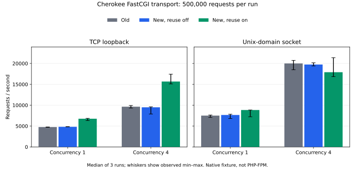

# Source connection reuse benchmark

This benchmark measures Cherokee's FastCGI transport overhead with a native C
backend fixture. PHP-FPM is unavailable in the measurement environment; these
results do not measure a PHP application, worker-pool exhaustion or remote
network latency.

The recorded measurements use benchmark harness commit `29cd7acd`. Build and
helper source fingerprints are preserved in the raw JSON.

## Method

- **500,000 measured requests per sample**, at concurrency **1** and **4**.
- Three repeats, with variant order rotated between repeats. TCP loopback and
  Unix-domain sockets are measured separately. Samples run sequentially.
- Compare the original implementation (`a60491c1`), the new implementation
  (`29a707b3`) with reuse disabled, and that same new build with reuse enabled.
  All 346 C/header source files in each build were verified against its commit.
- Both builds use `-g -O2`, without sanitizers, TLS, HTTP/2 or HTTP/3. Four
  Cherokee workers serve HTTP/1.1 requests in both builds. Frontend keepalive
  remains enabled, with exactly one frontend connection per load worker.
- Each sample starts fresh backend/server processes and performs **1,000
  warmup requests**, excluded from timings and measured backend accept counts.
- The backend uses one native event-driven process, with no thread/process
  creation per accepted connection. TCP responses use `TCP_NODELAY` in all
  variants. There is no artificial backend delay or application work.
- Every response contains exactly 128 bytes: the client request token, backend
  connection identity and fixed padding. All responses must have status 200,
  correct length and matching contents. Any failed response invalidates a run.
  Connection identities independently verify reuse and measured socket counts.
- Reuse retains at most four idle sockets, with a 60-second idle timeout,
  86,400-second lifetime and 65,535-request limit. Connections retire normally
  at the request-ID boundary; safeguards are not bypassed for the benchmark.
  Explicit backend deadlines are disabled and retries are zero in both new
  variants, keeping a failed attempt from being hidden by replay.
- CPU affinity separates Cherokee (logical CPUs 0–3), the backend (4–5) and
  clients (6–7). On this Ryzen 5 2500U these are respectively two, one and one
  physical cores, each with two hardware threads. The host remains a shared
  machine; it is not an isolated performance lab.
- `CLOCK_MONOTONIC` measures elapsed time and individual round-trip latencies.
  The measured interval starts when native client workers are released and
  ends at the last worker's completion. Response checks and latency collection
  are included; percentile sorting and result serialization are excluded.
  Cherokee/backend/client CPU time is also recorded. Linux process CPU ticks
  have 10 ms granularity on this machine.

There are 36 samples and **18,000,000 measured requests**, plus warmup. Raw
samples include build/library hashes, machine/compiler information, affinity,
load averages, failures, elapsed time, throughput, p50/p95/p99 latency and
backend connection counts. Results are saved atomically after every sample.
Summary values are medians of three runs, with minimum/maximum retained;
median run percentiles are not pooled percentiles over all three workloads.

## Reproduce

Build separate copies of the two commits with equivalent options:

```sh
./autogen.sh --disable-http2 --disable-http3 --with-libssl=no
make -j4
```

Then run from the working tree containing the benchmark harness:

```sh
python3 qa/benchmark_source_reuse.py \
  --old-tree /path/to/old-build \
  --new-tree /path/to/new-build \
  --output /path/to/results.json \
  --requests 500000 --warmup 1000 --repeat 3 \
  --transport tcp unix --modes old new_off new_on --concurrency 1 4 \
  --server-cpus 0,1,2,3 --backend-cpus 4,5 --client-cpus 6,7
```

The driver compiles [the native helper](../qa/source_reuse_bench.c) with
`cc -O2 -Wall -Wextra -Werror -std=c99`. It needs Python 3, a C compiler,
Linux `/proc`, and `taskset` when affinity options are used. Omit the CPU
options on a machine with another topology; record the changed conditions.

A short smoke run with 100,000 requests checked both concurrency levels and
crossed the FastCGI retirement boundary before the full workload began. Smoke
measurements are excluded from the requested results.

## Results

Completed 2026-10-05T21:14:26.416367+00:00 on AMD Ryzen 5 2500U with Radeon Vega Mobile Gfx; cc (Gentoo 16.2.1_p20260926 p1) 16.2.1 20260926.
All **18 million measured requests passed**, with zero client/backend errors.
The interrupted 10-million-request experiment and smoke runs are excluded.

The table reports medians of three 500,000-request samples. Throughput change
compares the old implementation with the new implementation using reuse.

| Transport | Concurrency | Old elapsed (s) | Reuse elapsed (s) | Old req/s | Reuse req/s | Change | Old / reuse sockets |
|---|---:|---:|---:|---:|---:|---:|---:|
| TCP | 1 | 104.78 | 74.00 | 4,772 | 6,757 | +41.6% | 500,000 / 8 |
| TCP | 4 | 51.86 | 31.91 | 9,641 | 15,669 | +62.5% | 500,000 / 8 |
| UNIX | 1 | 66.62 | 56.54 | 7,505 | 8,843 | +17.8% | 500,000 / 8 |
| UNIX | 4 | 25.00 | 27.93 | 20,001 | 17,905 | -10.5% | 500,000 / 8 |

Socket counts are distinct connections used during measurement, verified
from backend identities in responses. Reuse includes sockets opened during
warmup; normal retirement at 65,535 requests explains the replacement sockets.



### Controls, run ranges and latency

| Transport | Concurrency | Variant | Median req/s | Run range req/s | Median p50 / p95 / p99 (ms) |
|---|---:|---|---:|---:|---:|
| TCP | 1 | Old | 4,772 | 4,707–4,774 | 0.202 / 0.241 / 0.284 |
| TCP | 1 | New, reuse off | 4,820 | 4,805–4,867 | 0.199 / 0.240 / 0.278 |
| TCP | 1 | New, reuse on | 6,757 | 6,319–6,851 | 0.143 / 0.171 / 0.200 |
| TCP | 4 | Old | 9,641 | 9,317–9,926 | 0.333 / 0.524 / 0.683 |
| TCP | 4 | New, reuse off | 9,495 | 7,889–9,607 | 0.339 / 0.539 / 0.702 |
| TCP | 4 | New, reuse on | 15,669 | 15,102–17,430 | 0.217 / 0.345 / 0.461 |
| UNIX | 1 | Old | 7,505 | 7,078–7,646 | 0.124 / 0.160 / 0.191 |
| UNIX | 1 | New, reuse off | 7,659 | 6,808–7,830 | 0.122 / 0.156 / 0.188 |
| UNIX | 1 | New, reuse on | 8,843 | 7,225–8,855 | 0.106 / 0.140 / 0.169 |
| UNIX | 4 | Old | 20,001 | 18,490–20,729 | 0.179 / 0.259 / 0.339 |
| UNIX | 4 | New, reuse off | 19,746 | 19,401–20,164 | 0.178 / 0.264 / 0.348 |
| UNIX | 4 | New, reuse on | 17,905 | 16,845–21,389 | 0.191 / 0.315 / 0.404 |

The new-build/reuse-off control isolates enabling persistence from the other
implementation changes. The displayed ranges and plot whiskers are observed
minimum/maximum values, **not confidence intervals**. Three repeats on a
shared laptop do not establish statistical significance for small differences.

### CPU cost

Median process CPU milliseconds per completed request. Client CPU covers the
native load workers; coordinator sorting/serialization is excluded.

| Transport | Concurrency | Variant | Cherokee CPU ms/request | Backend CPU ms/request | Client CPU ms/request |
|---|---:|---|---:|---:|---:|
| TCP | 1 | Old | 0.1875 | 0.0542 | 0.0440 |
| TCP | 1 | New, reuse off | 0.1857 | 0.0536 | 0.0433 |
| TCP | 1 | New, reuse on | 0.1000 | 0.0236 | 0.0442 |
| TCP | 4 | Old | 0.2248 | 0.0525 | 0.0491 |
| TCP | 4 | New, reuse off | 0.2393 | 0.0528 | 0.0497 |
| TCP | 4 | New, reuse on | 0.1382 | 0.0219 | 0.0571 |
| UNIX | 1 | Old | 0.0834 | 0.0217 | 0.0438 |
| UNIX | 1 | New, reuse off | 0.0853 | 0.0216 | 0.0439 |
| UNIX | 1 | New, reuse on | 0.0786 | 0.0123 | 0.0366 |
| UNIX | 4 | Old | 0.1111 | 0.0158 | 0.0537 |
| UNIX | 4 | New, reuse off | 0.1118 | 0.0172 | 0.0554 |
| UNIX | 4 | New, reuse on | 0.1231 | 0.0112 | 0.0582 |

### Interpretation

TCP gains persist across the three comparisons. Unix results differ: the
throughput ranges overlap. At concurrency 4, reuse is slower in two repeats
and faster in the third; its median is lower than the old implementation.
Median Cherokee CPU cost increases for that concurrent Unix case even
though backend CPU cost falls. Profiling and additional controlled runs
are needed to explain that result. The connection-count reduction alone
does not establish a throughput improvement.

These numbers describe this local FastCGI fixture and the explicit reuse
policy above. They are not a prediction of PHP-FPM application throughput.
Actual PHP-FPM tests must include the application, child-pool capacity and
representative request work.

[Raw samples and fingerprints](source-reuse-benchmark.json) ·
[CSV samples](source-reuse-benchmark.csv) ·
[Standalone chart](source-reuse-benchmark.svg)
