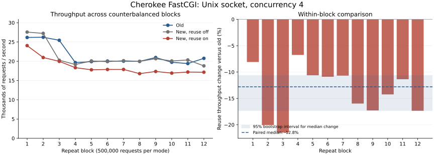

# Unix-socket concurrency-4 verification

The rerun reproduces lower throughput with reuse under these test conditions. Reuse was slower than the old build in **12 of 12 matched blocks**.
The median within-block throughput change was **-12.80%**, with an approximate
95% paired-bootstrap interval of **-17.31% to -10.64%**.
This is evidence for this fixture on this machine, not absolute certainty or a PHP-FPM prediction.

## Method

This follows the [original benchmark](source-reuse-benchmark.md), retaining its old/new
binaries, library hashes, helper source, build settings, source configuration and CPU affinity.
Their fingerprints and configuration were checked against the original raw data.
The benchmark driver is commit `cfea7721`; production code is unchanged.

- Unix-domain FastCGI backend, concurrency **4**, **500,000 measured requests per sample**.
- **12 repeat blocks**, each comparing old (`a60491c1`), new/reuse off, and new/reuse on
  (both `29a707b3`). All six mode orderings appear twice, with seed 20261005.
- **36 samples, 18,000,000 measured requests**, plus 1,000 warmup requests per sample.
  Each sample starts fresh processes. Every measured response passed status, length,
  request token and padding checks; backend connection identities independently verify reuse.
- Four persistent frontend connections and four Cherokee workers. Reuse retains at most
  four idle backend sockets; normal retirement is at 65,535 requests per socket.
- Cherokee uses logical CPUs 0–3, backend 4–5, clients 6–7. The native single-process
  event-driven backend returns 128 bytes without application work.
- Process CPU measurements and available host telemetry are recorded. CPU-frequency and
  governor data were unavailable. Available hwmon readings are not independently verified
  CPU-temperature measurements.

Started 2026-10-05T21:37:26.122122+00:00; completed 2026-10-05T21:52:49.436495+00:00 on AMD Ryzen 5 2500U with Radeon Vega Mobile Gfx.
The one-minute load average ranged from 0.48 to 6.57; nonzero available
thermal-sensor readings ranged from 60 to 86 °C. The shared host's
performance changed over time, as the graph shows. Counterbalanced ordering reduces
order bias but does not eliminate shared-host or thermal effects.

## Results

Values are medians of 12 samples per mode; ranges are observed minimum/maximum,
not confidence intervals. Latency values are medians of sample percentiles.

| Variant | Median req/s | Observed req/s range | Median elapsed (s) | Median p95 / p99 (ms) | Used backend sockets |
|---|---:|---:|---:|---:|---:|
| Old | 20,032 | 19,406–26,232 | 24.96 | 0.259 / 0.337 | 500,000–500,000 |
| New, reuse off | 20,108 | 18,802–27,570 | 24.87 | 0.260 / 0.340 | 500,000–500,000 |
| New, reuse on | 17,826 | 16,783–24,060 | 28.05 | 0.314 / 0.400 | 8–10 |

All **18 million measured requests passed**, with **zero client or backend errors**.
Used socket counts include sockets established during warmup. Retirement and uneven
use across sockets account for replacements and variation in reuse-mode counts.



### Paired analysis

Primary comparison: reuse on versus old, matched by repeat block. Each block's change is
`100 × (reuse_on_req_per_second / old_req_per_second − 1)`. The reported statistic is the
median of these 12 changes, not a ratio of mode medians. We resample whole blocks:
50,000 bootstrap samples of 12 blocks with replacement, seed 20261005. Endpoints are
the 2.5th and 97.5th percentile bootstrap medians. This approximate interval assumes
representative independent repeats; time-dependent shared-host conditions limit that assumption.

- **On versus old:** median -12.80%; interval -17.31% to -10.64%;
  slower in 12 blocks, faster in 0. Exact two-sided sign-test p = 0.000488.
- **On versus new/off (diagnostic):** median -12.08%; interval -15.81%
  to -9.48%; slower in 12 blocks, faster in 0.

The sign test omits exact ties and compares directions; it does not identify the cause.
Individual HTTP requests are not treated as independent benchmark repetitions.

| Block | Execution order | Old req/s | New off req/s | New on req/s | On vs old | On vs off |
|---|---|---:|---:|---:|---:|---:|
| 1 | New, reuse off → New, reuse on → Old | 26,178 | 27,570 | 24,060 | -8.09% | -12.73% |
| 2 | Old → New, reuse off → New, reuse on | 26,232 | 27,237 | 20,971 | -20.06% | -23.01% |
| 3 | Old → New, reuse on → New, reuse off | 25,440 | 20,256 | 19,974 | -21.49% | -1.39% |
| 4 | New, reuse on → New, reuse off → Old | 19,659 | 19,162 | 18,332 | -6.75% | -4.33% |
| 5 | New, reuse on → Old → New, reuse off | 19,895 | 20,080 | 17,784 | -10.61% | -11.44% |
| 6 | New, reuse off → Old → New, reuse on | 20,052 | 19,900 | 17,869 | -10.88% | -10.21% |
| 7 | Old → New, reuse on → New, reuse off | 20,012 | 20,135 | 17,876 | -10.67% | -11.22% |
| 8 | New, reuse off → Old → New, reuse on | 19,973 | 19,968 | 16,783 | -15.97% | -15.95% |
| 9 | New, reuse off → New, reuse on → Old | 20,970 | 20,665 | 17,348 | -17.27% | -16.05% |
| 10 | New, reuse on → New, reuse off → Old | 19,739 | 20,071 | 16,928 | -14.24% | -15.66% |
| 11 | New, reuse on → Old → New, reuse off | 19,406 | 20,336 | 17,201 | -11.36% | -15.42% |
| 12 | Old → New, reuse off → New, reuse on | 20,755 | 18,802 | 17,156 | -17.34% | -8.75% |

### CPU cost

Median process CPU microseconds per measured request, not wall-clock request latency.
Cherokee CPU ticks have 10 ms resolution. Client CPU covers native load workers;
coordinator percentile sorting and serialization are excluded.

| Variant | Cherokee CPU µs/request | Backend CPU µs/request | Client CPU µs/request |
|---|---:|---:|---:|
| Old | 99.8 | 16.6 | 54.8 |
| New, reuse off | 111.6 | 17.2 | 55.5 |
| New, reuse on | 118.6 | 11.2 | 56.2 |

## Practical interpretation

Keep backend reuse configurable. These results do not justify enabling it by default
for high-throughput Unix-socket sources. Earlier TCP gains are separate measurements;
real PHP-FPM application performance needs its own workload and capacity measurements.

The reuse path has a source-wide mutex shared by workers, pool-entry allocation/free
on each request, expiration bookkeeping, and two nonblocking socket-health peeks per
reuse cycle. Checkout checks health while holding the mutex. Unix connection setup
is relatively cheap, so added work and concurrent access can outweigh avoided setup.
Worker-local idle caches and retaining pool entries across uses are optimization candidates.
These are hypotheses from code inspection, not bottlenecks established by this benchmark.
CPU profiles, mutex/wait measurements and scheduling traces are needed to choose a fix.
Protocol-boundary validation and rejection of unread data must remain intact.

## Reproduce and data

Build instructions and fixture details are in the [original report](source-reuse-benchmark.md).
Run against the same old/new build trees:

```sh
python3 qa/benchmark_source_reuse.py \
  --old-tree /path/to/old-build --new-tree /path/to/new-build \
  --output /path/to/unix4-confirmation.json \
  --requests 500000 --warmup 1000 --repeat 12 \
  --transport unix --modes old new_off new_on --concurrency 4 \
  --server-cpus 0,1,2,3 --backend-cpus 4,5 --client-cpus 6,7 \
  --order balanced --seed 20261005
```

[Raw JSON with fingerprints and telemetry](source-reuse-unix4-verification.json)
and [per-sample CSV](source-reuse-unix4-verification.csv) preserve all 36 samples.
Original report/data remain available; smoke runs are excluded from this analysis.
